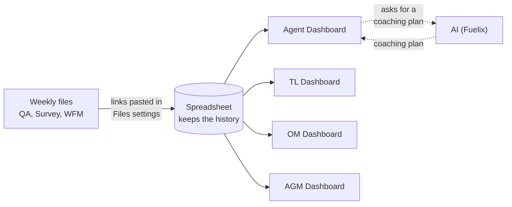

# Performance Dashboard

Performance dashboard for the **Mastercard Rewards** account (TELUS). It brings quality (QA), customer satisfaction (OSAT, ASAT, NPS) and, when data is available, WFM times for each agent into one place, and rolls them up the hierarchy: **Agent → Team Lead (TL) → Operation Manager (OM) → Account General Manager (AGM)**.

It is a **Google Apps Script web app** bound to a Google Sheet. The Sheet is the database, and the code lives in the Apps Script project of that same file.

## Menu

### Screens

Click a screen to read its documentation. Every section has a link to come back to this menu.

| Screen | Audience | What it shows |
|---|---|---|
| [Files settings](docs/screens.md#files-settings) | Whoever runs the weekly upload | Loads the 3 source files (QA, Survey, WFM) into the history |
| [Agent Dashboard](docs/screens.md#agent-dashboard) | TL / coach | Agent metrics + an AI-generated coaching plan |
| [TL Dashboard](docs/screens.md#tl-dashboard) | TL | Aggregated performance of their team |
| [OM Dashboard](docs/screens.md#om-dashboard) | OM | Comparison between the TLs they manage |
| [AGM Dashboard](docs/screens.md#agm-dashboard) | AGM | The whole account: KPIs, supervisor comparison and errors |

Also in [docs/screens.md](docs/screens.md): the account [targets](docs/screens.md#targets), the features shared by every screen ([copy as image, help button, headers](docs/screens.md#features-shared-by-every-screen)) and [what was removed on purpose](docs/screens.md#what-is-not-here-on-purpose).

### More documentation

- [Architecture](docs/architecture.md): files, sheets, data flow, caches and AI.
- [CLAUDE.md](CLAUDE.md): technical guide (clasp, Fuelix, working rules, known gotchas).

## How it works (in short)



The solid arrows carry numbers. The dotted arrows show the only place that uses AI: the Agent Dashboard.

Every dashboard section can be copied as an **image** (a button in the corner of each framed section) and each whole screen can be copied from the side menu, ready to paste into a slide or document. See [features shared by every screen](docs/screens.md#features-shared-by-every-screen).

1. Every week, the IDs of 3 source Google Sheets are pasted into **Files settings**.
2. The script reads them, joins them to the **Roster** and appends the rows to `History_QA`, `History_Survey` and `History_WFM`.
3. When a dashboard is opened, the server computes the metrics from those sheets and renders them in an HTML template.
4. Only the **Agent Dashboard** uses AI (Fuelix) to write the coaching plan. The TL, OM and AGM views are numbers only.

The full architecture is in [docs/architecture.md](docs/architecture.md).

## Repo layout

```
.
├── README.md            This file
├── CLAUDE.md            Technical instructions for Claude Code (clasp, Fuelix, working rules)
├── docs/
│   ├── architecture.md  How the script works: files, data flow, sheets, caches
│   └── screens.md       What each screen does
├── appsscript.json      Project manifest (time zone, services, web app settings)
├── *.js                 Server code (called .gs in Google)
└── *.html               UI shell and one template per dashboard
```

## Setting it up from scratch

> Requires Node 20 and an account with access to the Sheet. Exact commands and caveats are in [CLAUDE.md](CLAUDE.md).

1. Make a copy of the spreadsheet (**File → Make a copy**). This copies the script, but not its properties, triggers or deployments.
2. In the copy, go to **Project Settings → Script Properties** and create `FUELIX_API_KEY` with a valid key from [dev.fuelix.ai](https://dev.fuelix.ai).
3. Install clasp and sign in: `nvm use 20 && npm install -g @google/clasp && clasp login`.
4. Pull the code from the copy: `clasp clone <SCRIPT_ID_OF_THE_COPY>`.
5. Create the deployment: **Deploy → New deployment → Web app**.
6. Fill in `TL_Roster`, `OM_Roster` and `AGM_Roster` by hand and run the first upload in Files settings.
7. Optional: create the Script Property `HELP_LINK` with the URL of this documentation. A "?" help button appears at the bottom of the side menu only when it holds a valid `http(s)` URL. No new deployment is needed to change it.
