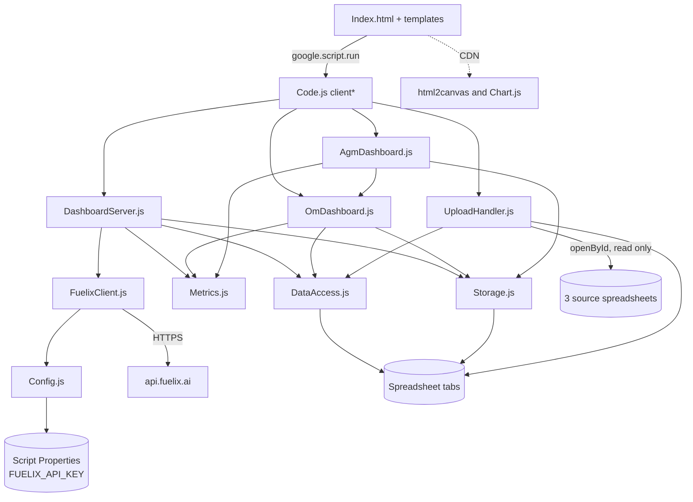
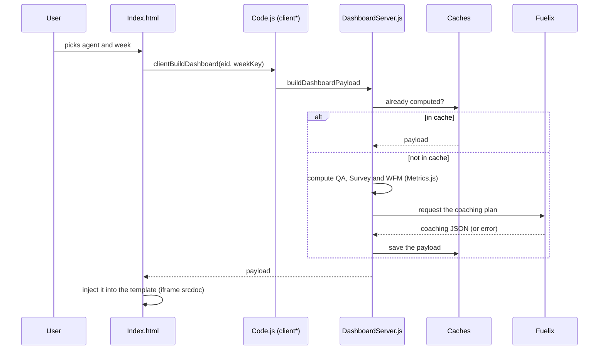

# Architecture

[← Back to the README menu](../README.md#menu)

How the script is built and how data flows through it.

**Jump to:**

- [Overview](#overview)
- [Entry point](#entry-point)
- [File map](#file-map)
- [Dependencies](#dependencies)
- [Spreadsheet tabs](#spreadsheet-tabs)
- [How data is joined](#how-data-is-joined)
- [Flow 1: weekly upload](#flow-1-weekly-upload)
- [Flow 2: opening a dashboard](#flow-2-opening-a-dashboard)
- [Caches](#caches)
- [AI (Fuelix)](#ai-fuelix)
- [Copy as image](#copy-as-image)
- [Design notes](#design-notes)

## Overview

- **Server** (`.js` files, called `.gs` in Google): reads the sheets, computes metrics and builds one JSON payload per screen.
- **Client** (`Index.html` + one HTML template per dashboard): requests the JSON and renders it.
- **Database**: the tabs of the spreadsheet itself (the script is *bound* and uses `SpreadsheetApp.getActiveSpreadsheet()`).
- **AI**: only the Agent Dashboard calls Fuelix. The AI never computes numbers; `Metrics.js` does.

There are no folders, no `import` and no build step: Apps Script shares a single global scope across all files. Private functions carry a `_` suffix by convention.

[← Back to the README menu](../README.md#menu) · [↑ Architecture index](#architecture)

## Entry point

`doGet(e)` in `Code.js` serves `Index.html` when the web app URL is opened. It accepts `?eid=<EID>` to open an agent's dashboard directly (deep link) and fills two placeholders in the page: `__DEEP_EID_PLACEHOLDER__` and `__HELP_LINK_PLACEHOLDER__` (the `HELP_LINK` script property, escaped).

After that, the UI calls the `client*` functions in `Code.js` through `google.script.run`. Those functions are a thin bridge to the rest of the code.

[← Back to the README menu](../README.md#menu) · [↑ Architecture index](#architecture)

## File map

| File | Role |
|---|---|
| `appsscript.json` | Manifest: time zone `America/Guatemala`, V8 runtime, web app (`executeAs: USER_DEPLOYING`) |
| `Code.js` | `doGet` + the `client*` functions the UI calls (including `clientCleanAgentCache`) |
| `Config.js` | `CONFIG` (sheet names, targets, Fuelix URL and model) and `getFuelixApiKey_()` |
| `UploadHandler.js` | Weekly upload: reads the 3 sources, joins to the Roster, computes the week and appends to history |
| `DataAccess.js` | Reads the Roster and `History_*`; `CRITERIA_MAP` (QA opportunity codes) |
| `Metrics.js` | Pure calculations: `computeQaMetrics`, `computeSurveyMetrics`, `computeWfmMetrics` |
| `DashboardServer.js` | Payload for the Agent and TL dashboards (with cache) |
| `OmDashboard.js` | Reads the leadership sheets and builds the OM dashboard payload |
| `AgmDashboard.js` | Builds the AGM dashboard payload (whole account, errors, week over week) |
| `Storage.js` | Per-agent state (`AppData`) and metrics caches (read, save, clear "All Time", delete one agent+week entry) |
| `FuelixClient.js` | The "Ascend" prompt and the Fuelix API call |
| `Index.html` | App shell: side menu, views, selectors, template loading, help button, "Copy screen as image" and the copy-section kit for the Agent, TL and OM templates |
| `DashboardTemplate.html` | Agent Dashboard template |
| `TeamDashboardTemplate.html` | TL Dashboard template |
| `OmDashboardTemplate.html` | OM Dashboard template |
| `AgmDashboardTemplate.html` | AGM Dashboard template |

[← Back to the README menu](../README.md#menu) · [↑ Architecture index](#architecture)

## Dependencies

[← Back to the README menu](../README.md#menu) · [↑ Architecture index](#architecture)

## Spreadsheet tabs

| Tab | Written by | Contents |
|---|---|---|
| `Roster` | The QA upload (**replaced entirely**) | Agent directory: EID, name, email, TL and their email, `Active?`… |
| `TL_Roster` | By hand | Each TL and the OM they report to (by email) |
| `OM_Roster` | By hand | The Operation Managers, with `Active?` |
| `AGM_Roster` | By hand | The Account General Manager (the first active row is used) |
| `History_QA` | The weekly upload | One row per quality evaluation |
| `History_Survey` | The weekly upload | One row per survey |
| `History_WFM` | The weekly upload | WFM times (see gotchas in `CLAUDE.md`) |
| `AppData` (hidden) | The app | Notes, role-play and streak per agent |
| `Processed_Metrics_Cache` | The app | Already-computed Agent Dashboard payloads |
| `TL_Metrics_Cache` | The app | Already-computed TL, OM and AGM payloads |

The leadership tabs (`TL_Roster`, `OM_Roster`, `AGM_Roster`) are manual **on purpose**: the QA upload replaces `Roster`, so any column added there would be lost. Format of these tabs: row 1 numbering, row 2 headers, data from row 3.

[← Back to the README menu](../README.md#menu) · [↑ Architecture index](#architecture)

## How data is joined

- QA is joined to the agent by **email**, Survey by **EID** and WFM by **Login ID**. The `Roster` is the bridge table.
- The hierarchy is joined by **email, case-insensitive**:
  - `TL_Roster.Team Leader Member Email` ↔ `Roster.Team Leader Email`
  - `OM_Roster.Operation Manager Email` ↔ `TL_Roster.Operation Manager Email`
- Every history row carries a **`WeekKey`** (the Monday of its week). QA uses `Evaluation Date`; Survey uses the `Call Date (…)` column.

[← Back to the README menu](../README.md#menu) · [↑ Architecture index](#architecture)

## Flow 1: weekly upload

The user-facing steps and the exact tabs and columns each source needs are in [Uploading the weekly files](uploading-data.md).

1. The user pastes the ID or URL of up to 3 spreadsheets into **Files settings** (each one is optional).
2. `processWeeklyUpload` opens each source with `openById` and reads the expected tab (`GCDC&C Responses`, `Raw`, `DATA AUX Engine`).
3. If QA is present, the `Roster` tab in that file replaces the local one.
4. Each row is joined to the Roster and gets its `WeekKey`.
5. `appendToHistory_` **appends** the rows to `History_*`.
6. The "All Time" cache is cleared.

Source IDs are not stored: they are pasted again on every upload.

[← Back to the README menu](../README.md#menu) · [↑ Architecture index](#architecture)

## Flow 2: opening a dashboard

The HTML templates receive the JSON by replacing the `__DATA_JSON_PLACEHOLDER__` marker and are loaded inside an `iframe` using `srcdoc`. The TL, OM and AGM views follow the same pattern, without the Fuelix step.

[← Back to the README menu](../README.md#menu) · [↑ Architecture index](#architecture)

## Caches

- Agent Dashboard key: `EID` + week (or `all`) in `Processed_Metrics_Cache`.
- TL, OM and AGM key: an id that includes the leadership mapping (for example `OM:<email>|<TL emails>`), in `TL_Metrics_Cache`. If the mapping changes, the id changes and an old payload is not reused.
- An upload clears only the "All Time" cache. **Weekly caches are permanent.**
- The full payload is stored, **including Fuelix errors**. The Agent Dashboard's **Clean** button deletes one agent's row for one period (the server only deletes rows whose coaching plan is an error). It does not recompute anything: the next time the agent is opened, the payload is rebuilt and Fuelix is called again.
- Each payload goes in a single cell: the Sheets limit is about 50,000 characters.

[← Back to the README menu](../README.md#menu) · [↑ Architecture index](#architecture)

## AI (Fuelix)

- Only in the Agent Dashboard, once per agent and week (after that it comes from cache).
- `FuelixClient.js` sends the "Ascend" system prompt and a summary of the agent's metrics to `POST https://api.fuelix.ai/v1/chat/completions`. The model is set in `CONFIG.FUELIX_MODEL`.
- The response is a JSON with the main opportunity code, insight, SMART goal, 5E roadmap, checklist, timeline, projection and a role-play scenario.
- If it fails (key, network, invalid or truncated response), `DashboardServer.js` stores `ascend = { error }` and the dashboard keeps showing every number. The Key Insight bar then shows a **Clean** button (see [Caches](#caches)).
- Data sent to the API: the agent's name, their metrics and the notes of their last 5 calls with QA under 80.

[← Back to the README menu](../README.md#menu) · [↑ Architecture index](#architecture)

## Copy as image

- **What:** every framed section can be copied as a PNG, and so can a whole screen. It is meant for pasting into slides and documents.
- **How:** html2canvas renders the DOM element to a canvas, then `navigator.clipboard.write` puts the PNG on the clipboard. If the clipboard is blocked, the PNG is downloaded instead.
- **Section buttons:** sections carry the CSS class `frame` (or `copyable`). The AGM template has its own buttons. For the Agent, TL and OM dashboards, `Index.html` injects the styles and buttons into each iframe when it loads (`setupFrameKit`), so those templates only mark their sections.
- **Whole screen:** the side-menu button (`copyScreen`) picks the current view (the active iframe's `.wrap`/`body`, or Files settings), expands scroll areas and renders everything except the side menu.
- Buttons and other controls marked `data-html2canvas-ignore` are left out of the image.

[← Back to the README menu](../README.md#menu) · [↑ Architecture index](#architecture)

## Design notes

- **One `google.script.run` call at a time.** Several simultaneous calls can return an intermittent null payload; that is why the UI loads the list and then the template, not both at once.
- **The payload goes through `JSON.parse(JSON.stringify(...))`** before leaving the server: `Date` objects break the Apps Script serializer.
- **`WeekKey` is normalized to text** on read, because Sheets silently turns ISO-looking dates into `Date` objects.
- **The TL, OM and AGM dashboards do not use AI**: everything is computed locally.
- **The cache is cleaned on purpose in a separate step.** The Clean button never triggers an AI call; generating and cleaning are kept apart so an accidental click costs nothing.

[← Back to the README menu](../README.md#menu) · [↑ Architecture index](#architecture)
