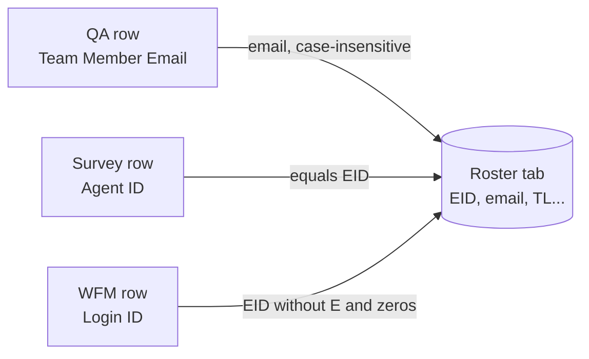

# Uploading the weekly files

[← Back to the README menu](../README.md#menu)

How to load the week's data into the dashboard, and what each source file must contain. Everything here is read from the code (`UploadHandler.js`, `DataAccess.js`, `Metrics.js`); names must match **exactly**, including capital letters and spaces.

**Jump to:**

- [Before you start](#before-you-start)
- [Step by step](#step-by-step)
- [The three source files](#the-three-source-files)
- [File 1: QA Evaluations](#file-1-qa-evaluations)
- [The Roster tab (inside the QA file)](#the-roster-tab-inside-the-qa-file)
- [File 2: Survey](#file-2-survey)
- [File 3: WFM](#file-3-wfm)
- [How rows are matched to agents](#how-rows-are-matched-to-agents)
- [What you see after processing](#what-you-see-after-processing)
- [Common problems](#common-problems)
- [Hand-maintained tabs (not uploaded)](#hand-maintained-tabs-not-uploaded)

## Before you start

- Each source must be a **Google Sheet**, not a loose `.xlsx` file. If you only have an Excel file, upload it to Google Drive and open it with Google Sheets (**File → Save as Google Sheets**) first.
- The account that **deploys** the web app (`executeAs: USER_DEPLOYING`) must have at least **read access** to the three sheets. The script opens them with `SpreadsheetApp.openById`.
- You need the **ID or the full URL** of each sheet. The ID is the part of the URL between `/d/` and `/edit`:
  `https://docs.google.com/spreadsheets/d/`**`<THIS_PART_IS_THE_ID>`**`/edit#gid=0`
- All three files are optional, but **at least one** is required.
- Upload **QA first**. The QA file carries the Roster that the other two files are matched against (see [How rows are matched to agents](#how-rows-are-matched-to-agents)).
- **Do not upload the same file twice.** The upload only appends, so repeating it duplicates the rows (see [Common problems](#common-problems)).

[← Back to the README menu](../README.md#menu) · [↑ Uploading index](#uploading-the-weekly-files)

## Step by step

1. Open **Files settings** in the side menu.
2. Click the **lock** icon at the top right of the card to unlock the fields.
3. Paste the ID or URL of each source sheet into its field:
   - **QA Evaluations** (`GCDC&C Responses`)
   - **Disputes / Survey Report** (`Raw`)
   - **WFM Aux Status** (`DATA AUX Engine`)
4. Click **Process & Save to History**. The button only turns on after a field has been changed.
5. Wait for the result. Large sheets can take a while ("Reading & joining to roster…").
6. Read the result box: rows added per source, whether the Roster was refreshed, and any warnings.

When it finishes, the fields lock again. The IDs are **not saved**: paste them again next week.

[← Back to the README menu](../README.md#menu) · [↑ Uploading index](#uploading-the-weekly-files)

## The three source files

| Field in the app | Tab the script reads | Header row | Columns read | Joined to the agent by |
|---|---|---|---|---|
| QA Evaluations | `GCDC&C Responses` | Row 1 | All | `Team Member Email` |
| Disputes / Survey Report | `Raw` | Row 1 | First 50 only | `Agent ID` |
| WFM Aux Status | `DATA AUX Engine` | **Row 19** | First 43 only | `Login ID` |

> **If the tab is missing, the script silently reads the first tab of the file** instead of failing. Check the tab names before uploading, or you may load the wrong data.

Whatever the columns are, **every source column is copied** to its history tab (`History_QA`, `History_Survey`, `History_WFM`). The script adds four columns in front: `WeekKey`, `WeekLabel`, `EID` and `UploadedAt`. The columns below are the ones the dashboards actually **use**; the rest are stored but ignored.

[← Back to the README menu](../README.md#menu) · [↑ Uploading index](#uploading-the-weekly-files)

## File 1: QA Evaluations

Tab: `GCDC&C Responses`. Row 1 holds the headers, data starts on row 2. One row per quality evaluation.

### General columns

| Column | Used for |
|---|---|
| `Team Member Email` | Matches the evaluation to an agent on the Roster (case-insensitive). |
| `Evaluation Date` | Decides the week (`WeekKey` = the Monday of that week). |
| `Evaluation Date Text` | Date shown in the QA call log (optional; falls back to `Evaluation Date`). |
| `Final Score` | The QA score (used for the QA average and trends). |
| `Mistakes with Critical Impact` | Counted as critical errors in the AGM view. |
| `Bank` | Shown in the QA call log (optional). |

### Criteria columns

Each criterion column holds `Yes`, `No` or `N/A`. An answer of **`No`** is counted as an **error** for that code. The header text must match exactly, **including the trailing space** shown with `␠` below.

| Code | Criterion column header | Reason column | Comment column |
|---|---|---|---|
| CF1 | `Provided a thorough and accurate resolution` | `CF1 reason` | `CF1 Comment` |
| CF2 | `Delivered Professional Service` | `CF2 reason` | `CF2 Comment` |
| CF3 | `Reduced the Customer Effort` | `CF3 reason` | `CF3 Comment` |
| CF4 | `Signposted next steps & shared Self-Service Solutions` | `CF4 reason` | `CF4 Comment` |
| BF1 | `Delivered Correct Opening & Closing Scripting␠` | `BF1 Reason` | `BF1 Comment` |
| BF2 | `Accurately Recorded Customer Contact␠` | `BF2 Reason` | `BF2 Comment` |
| BF3 | `Correctly transferred or Escalated to L2␠` | `BF3 Reason` | `BF3 Comment` |
| BF4 | `Knowledge Articles found, followed, or Suggested␠` | `BF4 Reason` | `BF4 Comment` |
| BF5 | `Tools & internal applications used accurately␠` | `BF5 Reason` | `BF5 Comment` |
| ComF1 | `Customer Identity and Security protocols followed accurately␠` | `ComF1 Reason` | `ComF1 Comment` |
| ComF2 | `Internal Compliance and/or applicable Legislative and Regulatory Rules adhered to␠` | `ComF2 Reason` | `ComF2 Comment` |

Notes:

- The CF reason columns use a lowercase `reason`; the BF and ComF ones use a capital `Reason`.
- The reason and comment texts are combined into the "key notes" of each call. Cells that are empty or `N/A` are skipped.
- Code names and labels are defined in `CRITERIA_MAP` (`DataAccess.js`) and listed in [screens.md](screens.md#agent-dashboard).

[← Back to the README menu](../README.md#menu) · [↑ Uploading index](#uploading-the-weekly-files)

## The Roster tab (inside the QA file)

The QA file must **also contain a tab called `Roster`**. On every QA upload that tab **replaces** the local `Roster` tab entirely (it is copied over; nothing is merged). If the QA file has no `Roster` tab, the Roster is not refreshed and the old one is used.

Layout of the tab:

- **Row 1:** numbering (ignored).
- **Row 2:** headers.
- **Row 3 onward:** one row per agent. Rows with an empty `EID` are ignored.

| Header | Meaning |
|---|---|
| `EID` | Employee ID, for example `E168483`. The key for every join. |
| `WID` | Worker ID column (read as is; not used for any join). |
| `Team Member` | Agent name. |
| `Team Member Email` | Agent email. Must match the QA file's `Team Member Email`. |
| `Team Leader` | Team Lead name. |
| `Team Leader Email` | Team Lead email. Links the agent to `TL_Roster`. |
| `Batch` | Training batch. |
| `Tenure` | Tenure in days. |
| `Tenure Group` | Tenure group. |
| `Channel` | Channel. |
| `Language` | Language. |
| `LOB` | Line of business. |
| `Level` | Level. |
| `Active?` | `Yes` for active agents. Only `Yes` counts; anything else is treated as inactive and hidden from the dashboards. |

[← Back to the README menu](../README.md#menu) · [↑ Uploading index](#uploading-the-weekly-files)

## File 2: Survey

Tab: `Raw`. Row 1 holds the headers. **Only the first 50 columns are read**, because the real export has hundreds of mostly empty columns. Any column the dashboards need must be within the first 50.

| Column | Used for |
|---|---|
| `Agent ID` | Must equal the Roster's `EID`. Rows without a match are saved with an empty `EID` and do not appear in any dashboard. |
| A column whose header **starts with** `Call Date (` | Decides the week. The text after the parenthesis does not matter. If no such column exists, or its date cannot be read, the row gets the week of the QA batch. |
| `OSAT` | Overall satisfaction. A score of **5** counts as satisfied: OSAT % = rows with 5 ÷ rows with a score above 0. |
| `Rep: OSAT` | Agent satisfaction (ASAT). Same rule: 5 counts. |
| `NPS Group` | Must be `Promoter` or `Detractor` (case-insensitive) to count. NPS = (promoters − detractors) ÷ rows with a group. Other values count only in the total. |

[← Back to the README menu](../README.md#menu) · [↑ Uploading index](#uploading-the-weekly-files)

## File 3: WFM

Tab: `DATA AUX Engine`. The headers are on **row 19**, not row 1; data starts on row 20. **Only the first 43 columns are read.**

| Column | Used for |
|---|---|
| `Login ID` | Matched to the agent. The script drops the leading `E` and leading zeros from the Roster `EID` (`E0168483` becomes `168483`) and compares it with this value. |
| `Date` | Decides the week. It stays a real date. |
| `ACD Calls` | Number of calls handled. |
| `AHT` | Average handle time. |
| `Staffed Time` | Staffed time. |
| `AUX Time` | Time in AUX states. |
| `ACW Time` | After-call work time. |
| `ACD Time` | Time on calls. |

Duration columns can arrive as real time values (for example a cell showing `0:00:00`). The script turns any such cell (except `Date`) into a number of **seconds**, so sums such as occupancy are correct.

> `History_WFM` is known to have a damaged header in the current data, so AHT and occupancy may come out empty. See the gotchas in [CLAUDE.md](../CLAUDE.md#known-gotchas).

[← Back to the README menu](../README.md#menu) · [↑ Uploading index](#uploading-the-weekly-files)

## How rows are matched to agents

- The **Roster** is the bridge table. That is why the QA file goes first: its `Roster` tab is refreshed **before** the Survey and WFM rows of the same upload are matched.
- A row with no match is still saved, but with an empty `EID`, and no dashboard shows it. The result box warns you with a count per source.
- **Week of each row:** the Monday of the date in `Evaluation Date` (QA), the `Call Date (…)` column (Survey) or `Date` (WFM). If a row has no usable date it gets the **batch week**: the most common week among the QA rows (or the current week if there are none). The result box shows this batch week.

[← Back to the README menu](../README.md#menu) · [↑ Uploading index](#uploading-the-weekly-files)

## What you see after processing

- The week label (for example "Week of Oct 12 – Oct 18, 2026") and the rows added per source.
- "Roster refreshed from the QA file" plus the number of agent rows, when the QA file had a `Roster` tab.
- A warning line when rows had no match: "N QA row(s) had no matching roster email", "N survey row(s) had no matching roster EID" or "N WFM row(s) had no matching roster login ID".
- The agent and Team Lead lists refresh by themselves.

Behind the scenes: the rows are appended to `History_QA`, `History_Survey` and `History_WFM`, and the "All Time" caches are cleared. Weekly caches are **not** cleared (see [architecture.md](architecture.md#caches)).

[← Back to the README menu](../README.md#menu) · [↑ Uploading index](#uploading-the-weekly-files)

## Common problems

| Symptom | Likely cause | What to do |
|---|---|---|
| "Enter at least one spreadsheet ID before processing." | All three fields are empty. | Fill in at least one. |
| "No usable rows found in the provided spreadsheet(s)…" | The tabs have no data rows. | Check the tab names and that data exists below the header row. |
| Percentages look right but counts are doubled or tripled | The same file was uploaded more than once. The upload only appends. | There is no automatic fix. Remove the duplicate rows from the `History_*` tab by hand, then clear the cache rows (see below). |
| Many "no matching roster…" warnings | The Roster is old, or the emails, `Agent ID` or `Login ID` do not match it. | Upload QA first; check that emails match exactly and that EIDs are consistent. |
| An agent or TL is missing from the dashboards | `Active?` is not `Yes`, or the TL email differs between `Roster` and `TL_Roster`. | Fix the values; matching is by email, case-insensitive. |
| The wrong data was loaded | The expected tab was missing, so the first tab was read silently. | Check the tab names. |
| Satisfaction shows "No data" for a week | The Survey `Call Date (…)` column was not read, so rows fell back to the batch week. | See gotcha 2 in [CLAUDE.md](../CLAUDE.md#known-gotchas). |
| A past week still shows old numbers after a fix | Weekly caches are permanent. | Delete the affected rows in `Processed_Metrics_Cache` and `TL_Metrics_Cache`. |
| Permission or "cannot open" error | The deploying account cannot read the source sheet. | Share the sheet with that account (read access is enough). |

[← Back to the README menu](../README.md#menu) · [↑ Uploading index](#uploading-the-weekly-files)

## Hand-maintained tabs (not uploaded)

These tabs are **not** part of the weekly upload. They are filled in by hand because the QA upload replaces the `Roster` tab and any column added there would be lost.

| Tab | Contents |
|---|---|
| `TL_Roster` | Each Team Lead and the Operation Manager they report to, by email. |
| `OM_Roster` | The Operation Managers (with `Active?` or `Active`). |
| `AGM_Roster` | The Account General Manager (the first active row is used). |

Format of the three tabs: row 1 numbering, row 2 headers, data from row 3. Matching is by **email, case-insensitive**, so emails must match the Roster. See [architecture.md](architecture.md#how-data-is-joined) for the exact column pairs and [screens.md](screens.md#om-dashboard) for how `Active?` affects the OM and AGM views.

[← Back to the README menu](../README.md#menu) · [↑ Uploading index](#uploading-the-weekly-files)
